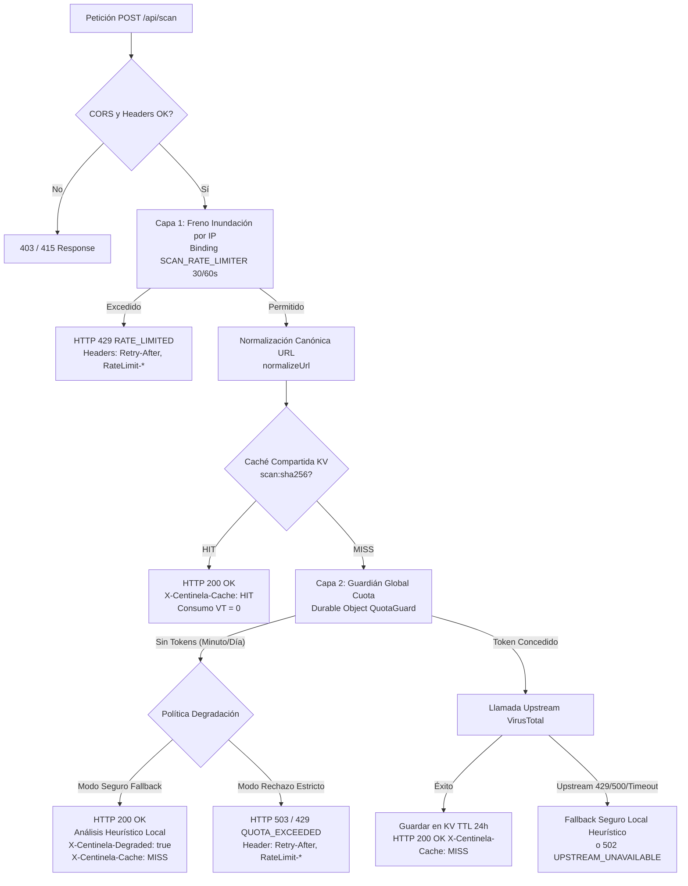

# Contrato Técnico y Arquitectura: Rate Limiting y Caché en Cloudflare Worker

**Proyecto:** Centinela PWA v2  
**Componente:** Cloudflare Worker (`worker/src/index.js`, `worker/src/quota-guard.js`)  
**Tarea Kanban:** `t_71a5622c` (Arquitectura)  
**Handoff a:** `t_b359b86d` (Dev: Implementación)  
**Fecha:** 2026-11-08  
**Autor:** Perfil Arquitectura (Arquitecto de Sistemas)  
**Estado:** APROBADO PARA IMPLEMENTACIÓN  

---

## 1. Contexto, Objetivos y Restricciones (NFRs)

### 1.1 Contexto del Problema
Centinela PWA v2 utiliza **VirusTotal v3** como su única fuente de inteligencia externa de reputación de URLs y dominios. La API pública de VirusTotal impone restricciones estrictas e inviolables:
- **Techo por minuto:** 4 peticiones por minuto (agregadas a nivel de cuenta/API Key).
- **Techo diario:** 500 peticiones por día (ventana de 24 horas UTC).

Si el Worker sobrepasa estos límites, VirusTotal responde con `HTTP 429 Too Many Requests`. Sin una gestión preventiva, un único usuario pulsando repetidamente el botón "Comprobar" o varios usuarios concurrentes navegando sobre enlaces sospechosos agotan la cuota global en menos de 60 segundos, dejando el servicio inoperativo para todos los usuarios.

### 1.2 Objetivos de Arquitectura
1. **Protección preventiva de cuota (O2):** Ninguna petición debe alcanzar la API de VirusTotal si el presupuesto de tokens del minuto (4) o del día (500) se ha agotado.
2. **Ahorro de cuota mediante caché compartida:** Si una URL ya fue analizada recientemente por cualquier usuario, la respuesta debe servirse desde la caché del Worker sin consumir llamadas a VirusTotal.
3. **Transparencia HTTP estandarizada:** Emitir cabeceras estándar de control de cuotas (`Retry-After`, `RateLimit-*`, `X-Centinela-Cache`) conforme a los RFCs aplicables (RFC 6585, RFC 9110, y draft-ietf-httpapi-ratelimit-headers).
4. **Degradación segura y honesta (O6):** Si la cuota se agota o la fuente externa falla, el sistema debe ofrecer un resultado degradado seguro (basado en análisis heurístico local de reputación) sin filtrar errores técnicos ni fallar con errores genéricos inesperados.
5. **Respeto absoluto al Free Tier de Cloudflare:** La solución debe operar íntegramente dentro de los límites gratuitos de Cloudflare Workers, Durable Objects y KV.

### 1.3 Restricciones Técnicas Comprobadas (Hechos Empíricos)
- **RT-1:** El binding nativo `[[ratelimits]]` de Cloudflare es *permissive* y de consistencia eventual. En las pruebas empíricas (`verificacion-binding-ratelimits.md`), 17 peticiones seguidas contra un límite de 4 no produjeron ningún bloqueo. **El binding no puede ni debe usarse para proteger la cuota de VirusTotal.** Su único rol legítimo es **freno de inundación por IP** (anti-acaparamiento).
- **RT-2:** El techo de cuota global exacto requiere un punto único de serialización con consistencia fuerte: el **Durable Object `QuotaGuard`**.
- **RT-3:** Cloudflare KV en plan gratuito ofrece **1.000 escrituras/día** y **100.000 lecturas/día**. Como el techo diario de VirusTotal es de 500 peticiones/día, el número de URLs nuevas analizadas por día nunca superará las 500 escrituras/día, garantizando un margen seguro del 50 % dentro de la cuota gratuita de KV.

---

## 2. Topología de Rate Limiting: Dos Capas Desacopladas

El sistema implementa dos capas de control ortogonales con propósitos y comportamientos diferenciados:



### 2.1 Capa 1: Freno de Inundación por IP (Anti-Acaparamiento)
- **Objetivo:** Evitar que un bot o script malicioso sature la infraestructura con cientos de peticiones por minuto desde una misma dirección.
- **Mecanismo:** Binding nativo `[[ratelimits]]` nombrado `SCAN_RATE_LIMITER`.
- **Límite:** **30 peticiones por 60 segundos por IP** (relajado a propósito según ADR-01 para acomodar múltiples usuarios legítimos tras un mismo CGNAT móvil).
- **Momento de ejecución:** ANTES de leer y parsear el cuerpo JSON de la petición (mitigación de seguridad H-3).
- **Respuesta al exceder:** `HTTP 429 Too Many Requests`.

### 2.2 Capa 2: Guardián Global Exacto de Cuota Upstream (`QuotaGuard`)
- **Objetivo:** Garantizar que la cuenta de Centinela nunca supere 4 req/min ni 500 req/día hacia VirusTotal.
- **Mecanismo:** Durable Object con persistencia en storage (`QuotaGuard`, instancia singleton nombrada `vt-quota`).
- **Ventana de minuto:** Ventana deslizante/bloque de 60.000 ms. Límite: 4 tokens.
- **Ventana de día:** Ventana fija de 86.400.000 ms UTC. Límite: 500 tokens.
- **Atomicidad:** Serialización nativa de eventos del Durable Object (garantía de que ningún `get` se intercala con un `put` concurrente).
- **Momento de ejecución:** DESPUÉS de comprobar la caché del Worker. Si la URL está en caché, **no se pide token al DO**, ahorrando cuota.

---

## 3. Estrategia de Caché en Cloudflare Worker

### 3.1 Evaluación Técnica de Opciones (ADR-02)

| Criterio | Cache API (`caches.default`) | Cloudflare Workers KV | Map en memoria (Isolate) | Durable Object Storage |
|---|---|---|---|---|
| **Alcance** | Local al centro de datos (colo) | Global (consistencia eventual ~60s) | Local a la instancia efímera | Global (consistencia fuerte) |
| **Persistencia a despliegues** | Sí (según TTL y caché CDN) | Sí (persistente) | No (se borra en cada deploy) | Sí (SQLite subyacente) |
| **Soporte POST nativo** | Requiere emular `Request` GET sintética | Directo (clave/valor arbitrario) | Directo en RAM | Directo en SQLite |
| **Límites Free Tier** | Purgas LRU agresivas en poco tráfico | 1.000 writes/día, 100k reads/día | Limitado por memoria isolate (128 MB) | 100k reads/día, 100k writes/día |
| **Coste operativo** | Manejo de Request/Response sintéticos | Simple (`env.CENTINELA_CACHE.get/put`) | No viable para producción | Complejidad de llamadas RPC al DO |

### 3.2 Decisión de Arquitectura: Cloudflare KV (`CENTINELA_CACHE`)
Se adopta **Cloudflare KV** como el almacén oficial de caché compartida del Worker para análisis de URLs y dominios.

**Justificación:**
1. **Persistencia global:** Las URLs cacheadas por un usuario en Madrid quedan disponibles para un usuario en Barcelona o Buenos Aires en pocos segundos.
2. **Alineación de cuotas:** Dado que el límite de VirusTotal es de 500 req/día, la tasa máxima teórica de inserciones en KV es de 500 escrituras/día. El plan gratuito de Cloudflare otorga 1.000 escrituras/día, dejando un 50 % de margen holgado.
3. **Tolerancia a fallos (Fail-open):** Si el binding `CENTINELA_CACHE` no estuviera configurado o fallara temporalmente, el Worker continúa procesando el análisis contra VirusTotal (o degradación) sin arrojar un error 500.

### 3.3 Normalización Canónica y Clave de Caché (Regla Única RC-04)
Para evitar que variaciones cosméticas de una URL quemen cuota o causen dispersión de caché, se aplica la función única de normalización canónica (`normalizeUrl` de `core/validation.js`).

**Transformaciones:**
1. Forzar esquema canónico `https:` para la clave de caché.
2. Host en minúsculas, eliminación de `www.` inicial y puerto por defecto (`:443`, `:80`).
3. Eliminación absoluta de fragmentos `#...`.
4. Eliminación de parámetros de seguimiento y analítica (tracking params):
   `utm_*`, `fbclid`, `gclid`, `dclid`, `msclkid`, `mc_eid`, `igshid`, `si`, `srsltid`, `_ga`, `_gl`, `ref`, `twclid`.
5. Ordenación alfabética estricta de query params restantes.
6. Generación del hash criptográfico SHA-256 (Web Crypto API):
   $$\text{Clave} = "scan:" + \text{HEX}(\text{SHA-256}(\text{URL normalizada}))$$

### 3.4 Política de TTL y Estructura del Registro en Caché
- **TTL para URLs con veredicto final:** **86.400 segundos (24 horas)** (`expirationTtl: 86400`).
- **TTL para URLs no encontradas / en análisis preliminar (VT 404/queued):** **No cachear** o cachear con TTL ultracorto (**60 segundos**) para permitir que el análisis real de VirusTotal complete su procesamiento.

**Estructura del Payload en KV:**
```json
{
  "targetUrl": "https://ejemplo.com/path",
  "verdictInputs": {
    "malicious": 0,
    "suspicious": 1,
    "harmless": 65,
    "undetected": 4,
    "timeout": 0,
    "total": 70
  },
  "scanDate": 1794154800,
  "finalUrl": "https://ejemplo.com/path",
  "title": "Ejemplo Seguro",
  "engines": {
    "Kaspersky": { "category": "suspicious", "result": "phishing" }
  },
  "permalink": "https://www.virustotal.com/gui/url/abc.../detection",
  "source": "virustotal",
  "cachedAt": "2026-11-08T17:20:00.000Z",
  "version": "2.3.0"
}
```

---

## 4. Contrato de Cabeceras HTTP (Estándar IETF)

Toda respuesta de la API `/api/scan` y `/api/local-check` debe incluir cabeceras canónicas que informen al cliente del estado de la cuota, reintentos y caché.

### 4.1 Definición de Cabeceras

| Cabecera | Tipo / Formato | Descripción | Aplicabilidad |
|---|---|---|---|
| `Retry-After` | Entero (segundos) | Tiempo de espera recomendado antes de reintentar la operación (RFC 7231 §7.1.3 / RFC 9110). | Obligatoria en respuestas `429` y `503`. |
| `RateLimit-Limit` | Entero | Número máximo de peticiones permitidas en la ventana actual. | En respuestas normales y en límite. |
| `RateLimit-Remaining` | Entero | Peticiones restantes en la ventana actual antes de bloqueo. | En respuestas normales y en límite. |
| `RateLimit-Reset` | Entero (segundos) | Segundos restantes hasta que se renueve la cuota de la ventana. | Obligatoria en respuestas `429` y `503`. |
| `RateLimit-Policy` | Cadena estructurada | Definición formal de la cuota: `"<limit>;w=<window_seconds>"`. | Informativa. Ej: `"4;w=60"` o `"30;w=60"`. |
| `X-Centinela-Cache` | Enum (`HIT` \| `MISS` \| `BYPASS`) | Diagnóstico de resolución de la caché del Worker. | En todas las respuestas `200 OK`. |
| `X-Centinela-Degraded` | Booleano (`true` \| `false`) | Indica si el resultado proviene del motor degradado local por cuota agotada. | Presente cuando se active degradación. |

### 4.2 Matriz de Respuestas HTTP y Cabeceras

#### Caso A: Éxito servido desde Caché del Worker (`200 OK`)
```http
HTTP/1.1 200 OK
Content-Type: application/json; charset=utf-8
X-Content-Type-Options: nosniff
Referrer-Policy: no-referrer
Permissions-Policy: geolocation=(), microphone=(), camera=()
Cache-Control: no-store
Vary: Origin
Access-Control-Allow-Origin: https://centinela-pwa.pages.dev
X-Centinela-Cache: HIT
X-Centinela-Degraded: false

{
  "url": "https://ejemplo.com",
  "verdictInputs": { ... },
  "source": "virustotal",
  "cached": true,
  "version": "2.3.0"
}
```

#### Caso B: Éxito con llamada a VirusTotal (`200 OK`)
```http
HTTP/1.1 200 OK
Content-Type: application/json; charset=utf-8
X-Content-Type-Options: nosniff
Referrer-Policy: no-referrer
Access-Control-Allow-Origin: https://centinela-pwa.pages.dev
X-Centinela-Cache: MISS
X-Centinela-Degraded: false
RateLimit-Limit: 4
RateLimit-Remaining: 2
RateLimit-Reset: 34
RateLimit-Policy: "4;w=60"

{
  "url": "https://ejemplo.com",
  "verdictInputs": { ... },
  "source": "virustotal",
  "cached": false,
  "version": "2.3.0"
}
```

#### Caso C: Freno de Inundación por IP superado (`429 Too Many Requests`)
Emitido cuando una única IP realiza más de 30 peticiones en 60 segundos:
```http
HTTP/1.1 429 Too Many Requests
Content-Type: application/json; charset=utf-8
X-Content-Type-Options: nosniff
Referrer-Policy: no-referrer
Access-Control-Allow-Origin: https://centinela-pwa.pages.dev
Retry-After: 45
RateLimit-Limit: 30
RateLimit-Remaining: 0
RateLimit-Reset: 45
RateLimit-Policy: "30;w=60"

{
  "error": {
    "code": "RATE_LIMITED",
    "message": "Has hecho demasiadas comprobaciones seguidas. Espera un momento e inténtalo de nuevo."
  }
}
```

#### Caso D: Cuota Global de VirusTotal Agotada (`503 Service Unavailable`)
Emitido cuando el DO `QuotaGuard` detecta agotamiento de tokens por minuto (< 4) o por día (< 500) y se opta por rechazo explícito:
```http
HTTP/1.1 503 Service Unavailable
Content-Type: application/json; charset=utf-8
X-Content-Type-Options: nosniff
Referrer-Policy: no-referrer
Access-Control-Allow-Origin: https://centinela-pwa.pages.dev
Retry-After: 60
RateLimit-Limit: 4
RateLimit-Remaining: 0
RateLimit-Reset: 60
RateLimit-Policy: "4;w=60"

{
  "error": {
    "code": "QUOTA_EXCEEDED",
    "message": "El servicio de análisis en la nube está muy solicitado en este momento. Inténtalo dentro de un minuto."
  }
}
```
*(Nota: Si el agotamiento es por la cuota diaria de 500, `Retry-After` y `RateLimit-Reset` reflejarán los segundos restantes hasta las 00:00:00 UTC).*

---

## 5. Comportamiento Degradado Seguro (Safe Graceful Degradation)

### 5.1 Filosofía de Resiliencia
Centinela PWA v2 integra un potente motor de reputación y análisis heurístico offline (`js/core/reputation-offline.js` y `worker/src/reputation.js`), capaz de detectar:
1. Nombres de dominio con alta entropía de Shannon (generados algorítmicamente / DGA).
2. TLDs de alto riesgo abusivo (`.zip`, `.mov`, `.top`, `.xyz`, `.click`, `.buzz`...).
3. Patrones de phishing por suplantación de marcas populares (`paypal-login`, `banco-santander-update`...).
4. URLs excesivamente largas o con subdominios anidados fraudulentos.

Cuando la cuota de VirusTotal se agote (o VirusTotal experimente una caída upstream 502/timeout), el Worker no debe dejar al usuario a ciegas si puede proporcionarle un veredicto heurístico preliminar de protección inmediata.

### 5.2 Contrato de Respuesta Degradada Segura
Cuando se activa la degradación segura ante cuota agotada:
- **HTTP Status:** `200 OK` (evita que el cliente lance excepción genérica de red o pantalla de caída).
- **Cabeceras:**
  - `X-Centinela-Degraded: true`
  - `X-Centinela-Cache: MISS`
  - `Retry-After: <segundos_para_reintentar_analisis_exhaustivo>`
- **Cuerpo JSON:**
```json
{
  "url": "https://ejemplo-sospechoso.xyz/login",
  "degraded": true,
  "degradedReason": "UPSTREAM_QUOTA_EXCEEDED",
  "source": "local_heuristics",
  "verdictInputs": {
    "malicious": 0,
    "suspicious": 1,
    "harmless": 0,
    "undetected": 0,
    "timeout": 0,
    "total": 0
  },
  "heuristics": {
    "entropy": 4.12,
    "riskTld": true,
    "subdomainCount": 3,
    "reasons": [
      "TLD de riesgo frecuente en campañas maliciosas (.xyz)",
      "Estructura del dominio con entropía inusual"
    ]
  },
  "notice": "Comprobación de emergencia activa: el análisis exhaustivo en la nube está temporalmente saturado; se ha evaluado mediante heurística local de seguridad.",
  "cached": false,
  "version": "2.3.0"
}
```

### 5.3 Reglas de Seguridad en Degradación
1. **Nunca exponer tokens ni URLs de VirusTotal:** Ni en mensajes de error ni en cabeceras.
2. **Inmutabilidad de errores:** La respuesta degradada nunca debe simular un análisis de motores AV si no existieron. `total: 0` y `source: "local_heuristics"` dejan constancia transparente para el motor de clasificación del frontend (`core/verdict.js`).

---

## 6. Handoff y Guía de Implementación para Dev (`t_b359b86d`)

### 6.1 Ficheros Implicados
- `worker/src/index.js` (Intercepción, headers, orquestación de caché KV y degradación).
- `worker/src/quota-guard.js` (Soporte de consulta de contadores para cabeceras `RateLimit-*`).
- `worker/wrangler.toml` (Declaración del binding KV `CENTINELA_CACHE`).
- `tests/worker/scan.test.js` y `tests/worker/quota-guard.test.js` (Ampliación de suites de prueba).

### 6.2 Checklist de Implementación para Dev
- [ ] **1. Binding de KV:** Añadir a `worker/wrangler.toml`:
  ```toml
  [[kv_namespaces]]
  binding = "CENTINELA_CACHE"
  id = "centinela_cache_prod"
  preview_id = "centinela_cache_preview"
  ```
- [ ] **2. Consulta de Caché:** En `handleScan`, calcular `scanKey = 'scan:' + sha256(canonicalUrl)`. Si existe en `env.CENTINELA_CACHE`, responder directamente con `X-Centinela-Cache: HIT` sin llamar a `acquireQuota`.
- [ ] **3. Inyección de Cabeceras:** Asegurar que `jsonResponse` y `errorResponse` incluyan las cabeceras `Retry-After`, `RateLimit-Limit`, `RateLimit-Remaining` y `RateLimit-Reset` según corresponda.
- [ ] **4. Escritura en Caché:** Tras recibir respuesta satisfactoria de VirusTotal, ejecutar `await env.CENTINELA_CACHE.put(scanKey, JSON.stringify(data), { expirationTtl: 86400 })`.
- [ ] **5. Manejo Fail-Open:** Si `env.CENTINELA_CACHE` es indefinido (entornos de test sin mock o sin binding), saltar la caché limpiamente sin lanzar excepción.
- [ ] **6. Tests de Regresión:** Ejecutar `npm test` garantizando que los **270 tests actuales se mantengan 100 % en verde** y añadir los tests específicos de cabeceras y caché.

---

## 7. Registro de Decisiones de Arquitectura (ADR Summary)

- **ADR-01: Freno por IP a 30/60s:** Reconoce el uso masivo de CGNAT en conexiones móviles y desacopla la protección de IP de la protección de cuota de VirusTotal.
- **ADR-02: Cloudflare KV para Caché del Worker:** Seleccionado por persistencia multi-centro de datos y perfecta compatibilidad con el límite de 500 req/día de VirusTotal frente a la cuota gratuita de 1.000 escrituras de KV.
- **ADR-03: Formato IETF para Cabeceras RateLimit:** Garantiza interoperabilidad estándar para clientes PWA y herramientas de observabilidad.
- **ADR-04: Degradación Heurística Local:** Transforma un fallo de disponibilidad de upstream en un servicio degradado seguro y comprensible para el usuario familiar.